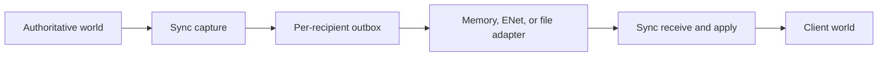

# Replication architecture

[README](../README.md) · [Integration](usage.md) · [API](api.md)

This guide explains the replication model for application and adapter
authors. It assumes familiarity with Flecs worlds and reflected components.
The [module design][modules] establishes the architecture; the
[public API design][api-design] and [header](../include/sync.h) specify its
concrete contracts.

## Responsibilities

| Module | Responsibility |
| --- | --- |
| Sync | Schema, identities, visibility, capture, codec, queues, apply. |
| EnetSync | Connections, reliable packet delivery, network servicing. |
| FileSync | Framed recording, replay, file validation, inspection. |

This repository builds Sync and the optional FileSync and EnetSync libraries
as separate targets with a shared release and integration suite. The core
builds independently with `SYNC_BUILD_FILE_SYNC=OFF` and
`SYNC_BUILD_ENET_SYNC=OFF`. EnetSync lives in `adapters/enet_sync`; see its
[integration guide](enet-sync.md). Both adapters use the same frames and
client decoder; neither introduces another replication algorithm. FileSync
uses only the public Sync
interface, including copied session information for scheduling and limits.

Import registers declarations. Creating a session activates replication.
Neither operation opens a transport. Each world has at most one active
session; many worlds can coexist in a process without sharing session state
or mutable module IDs.

## Sampled state and visibility

The server owns synchronized values and replicated entity lifetimes. A
capture samples the final state at its tick. Intermediate writes can collapse
into one value, and an entity created and deleted between captures may never
appear on a client. Deliver required gameplay events separately.

An eligible entity directly owns a registered synchronized component or tag
and has a recipient policy. `ReplicateToAll` includes every healthy recipient;
direct `(ReplicateTo, peer)` pairs add individual recipients. Their union is
the visible set. No policy means no recipient. Prefabs, disabled entities,
and peer entities are excluded.

| Current eligibility for a peer | Queued membership | Next update |
| --- | --- | --- |
| Visible | Unknown | Introduce full synchronized state. |
| Visible | Known | Send changes and membership differences. |
| Invisible or deleted | Known | Remove the replica. |
| Invisible | Unknown | No entity operation. |

Removing the final synchronized type makes an entity ineligible. Visibility
reentry sends full state even if no value changed. Local-only components on
a client replica survive ordinary value updates but disappear with that
replica on visibility loss, reset, or session destruction.

## Capture once, distribute to recipients

At a writable boundary, the server completes these steps:

1. Merge application writes and policy changes; assign missing network IDs
before iterating component storage.
2. Determine recipient membership and consume shared dirty queries once.
3. Copy or encode values into owned capture storage; retain structural
changes and deleted identities independently of live component pointers.
4. Reconcile each peer against its state after the last retained update.
5. Retain a complete update in that peer's outbox, then advance its baseline.

[Flecs change detection][queries] operates at table/component granularity.
Writers must use tracked ECS operations or report `ecs_modified_id` after
pointer writes. Changed tables can cause unchanged rows to be resent.
Per-recipient query consumption must not hide changes from subsequent peers.
New visibility uses a full-state path even when dirty queries are clean.

Structural changes coalesce against the sampled state. An unknown entity's
add-then-remove needs no publication; remove-then-add on a known entity sends
the final replacement. Encoded values may be shared, but visibility lists,
stream headers, and membership baselines belong to each peer.

A lost capture cannot silently advance a baseline. Recoverable retained
records preserve changes; otherwise the affected stream faults and needs a
new snapshot. Arbitrarily dropping a queued delta breaks later dependencies.

## Identity and schema

A server-session identity plus `NetworkId` identifies a remote entity.
Clients map it to their own Flecs entity IDs. IDs remain assigned while an
entity is hidden, retire on deletion, and never wrap or get reused within the
server session. Reusing a native Flecs slot does not reuse its network ID.

Every non-null reflected entity reference must target the recipient's
resulting visible set. Visibility changes require reference validation even
without a component write. Invalid reference closure faults that recipient;
it never grants visibility to a hidden target. Local-only entities and assets
have no implicit network identity mapping.

Session creation freezes the marked type registry. The manifest includes
every synchronized type, including currently unused types. Clients require
compatible marked definitions by qualified name; extra local types are fine.
Wire compatibility uses canonical shapes, member names and order, scalar
widths, fixed array counts, and enum definitions. Native IDs, offsets,
alignment, padding, and registration order do not establish compatibility.
A fingerprint accelerates comparison but does not replace shape validation.

[Flecs Meta][meta] supplies reflection for the shared codec. Sync encodes
fields independently with little-endian integers and preserved IEEE-754
binary32/binary64 representations. Nullable strings distinguish null from
empty; they contain bytes, need not be UTF-8, and cannot contain embedded NUL.
Enum and bitmask values preserve unnamed representable values and bits.
Native lifecycle hooks must correctly manage owned values during decoding.

The [API guide](api.md#schema-and-limits) lists supported types and limits.
Host enums and public structs are not serialized layouts or a stable ABI.
Adapters use `sync_frame_inspect` for envelopes and leave payload decoding to
the core; this guide does not assign wire offsets or numeric discriminants.

## Stream and publication

A new peer waits until capture tick T for its manifest and complete snapshot.
Later deltas cannot overtake that snapshot. Each subsequent capture emits one
logical update, including an empty delta, for every healthy ready peer.

Frames carry protocol version, kind, server identity, stream ID, sequence,
tick, and payload length. Sequences start at one and advance by exactly one.
Snapshot frames share a tick; later updates advance ticks. Missing, repeated,
out-of-order, or foreign-stream frames are errors.

The manifest fits one bounded frame. Snapshots use begin/data/end frames;
large deltas use fragments. A value can span frames, but the entire logical
update must fit its configured bound. Assembly can progress with a receive
queue smaller than the logical update.

The client validates and decodes a complete update before mutating its world.
It allocates introduced entities before resolving references, applies values
and component removals, then deletes departing replicas. Downstream systems
see completed updates. Observers can see individual mutations: publication
does not provide transaction isolation or rollback after a runtime failure.

## Adapter obligations

Only one delivery consumer drains a peer outbox. It borrows a frame, accepts
responsibility for its bytes, then commits that exact token. Core retention,
adapter acceptance, and client publication are distinct milestones.

EnetSync services ENet independently of capture frequency and uses reliable
packets on one replication channel. It copies frames into transport-owned
storage and commits only after send acceptance. [ENet packet ownership][enet]
also requires releasing received packets after copying or accepting their
contents. Backpressure requires retaining the same frame or closing the
stream. Transport backlog needs its own bound after core commit.

[FileSync](file-sync.md) records each recipient stream with a file header and
records holding a length, unchanged frame bytes, and a checksum. File and
protocol versions are independent. Standalone replay starts with a manifest
and full snapshot.
Recording commits only after completing a record; a partial write faults the
recorder and must not be retried from the record's beginning. Buffered write,
flush, and durable synchronization are separate completion policies.

Replay validates records and retains an unaccepted record across backpressure.
Frame stepping differs from completed-update stepping. Record-boundary EOF
still requires `sync_client_finish` to check logical completeness; partial
records and unfinished snapshots or deltas are truncation. Replay reconstructs
synchronized state, not the unsynchronized game simulation.

A live recorder receives a copy from the network consumer, rather than
independently draining the same peer. Disconnect recovery resets the client
and establishes a fresh stream and snapshot. Shutdown stops adapters before
destroying sessions, then finalizes worlds.

[modules]: https://chatgpt.com/space/page_bff89c33d07c8191bfecb3c681db1405
[api-design]: https://chatgpt.com/space/page_bc72b5d6c7b48191a202e24b430c5cb7
[queries]: https://www.flecs.dev/flecs/Queries.html#change-detection
[meta]: https://www.flecs.dev/flecs/group__c__addons__meta.html
[enet]: https://github.com/lsalzman/enet/blob/master/docs/tutorial.dox
